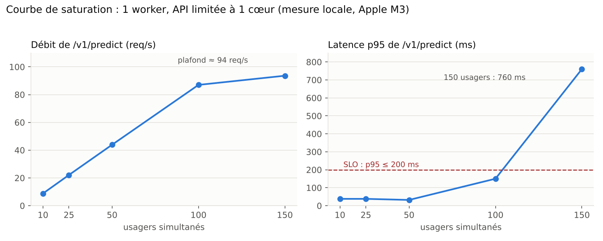

# velov-mlops

Projet fil rouge du cours **Industrialisation de l'IA dans le Cloud** (M2 Data Engineering / IA).

Objectif métier : prédire, pour chaque station Vélo'v, le nombre de vélos disponibles **dans une heure**,
et servir cette prédiction via une API fiable, conteneurisée, puis déployée (on-premise et cloud).

Pour lancer le projet pas à pas, voir [README_EXECUTION.md](README_EXECUTION.md).

## Progression par session

Chaque étape du cours correspond à un tag git. Absent ou bloqué : repartez du tag de fin de la session précédente.

| Tag | Contenu |
|---|---|
| `s1-start` | Données simulées, features, entraînement. API à compléter (TP1) |
| `s1-end` | Modèle v0 servi par FastAPI, tests pytest |

```bash
git checkout s1-end          # récupérer l'état de fin de S1
git checkout -b mon-binome   # travailler sur sa propre branche
```

## Démarrage rapide

Prérequis : Python 3.11+ (3.12 recommandé), git. Docker sera nécessaire en S2.

```bash
python -m venv .venv
source .venv/bin/activate            # Windows : .venv\Scripts\activate
pip install -r requirements-dev.txt
pip install -e .                     # rend le package velov importable

python -m velov.data                 # génère data/velov_history.csv (simulateur, seed fixe)
python -m velov.train                # entraîne et écrit models/model.joblib + models/metadata.json
python -m velov.train --mlflow       # idem + journalisation MLflow (puis : mlflow ui)
pytest                               # tests
uvicorn velov.api.main:app --reload  # API sur http://127.0.0.1:8000/docs (--reload : en dev uniquement)
```

Exemple d'appel :

```bash
curl -X POST http://127.0.0.1:8000/v1/predict \
  -H "Content-Type: application/json" \
  -d '{"station_id": 3, "timestamp": "2026-10-06T08:00:00+02:00", "capacity": 20,
       "bikes_available": 12, "temperature": 14.5, "is_raining": false}'
```

Le `timestamp` doit porter un fuseau (`+02:00`, `Z`...) : sans fuseau, l'API répond 422.
Les instants sont renvoyés et journalisés en UTC (`"target_timestamp": "2026-10-06T07:00:00Z"`).

## Démarrer l'API et PostgreSQL avec Docker Compose

Générez le modèle une fois avant de construire l'image (voir les commandes de démarrage ci-dessus), puis configurez le mot de passe local :

```bash
cp secrets/postgres_password.example secrets/postgres_password
cp secrets/pgadmin_password.example secrets/pgadmin_password
# Remplacez le contenu de secrets/postgres_password par un mot de passe local.
# Remplacez aussi le contenu de secrets/pgadmin_password.
chmod 600 secrets/postgres_password secrets/pgadmin_password
docker compose up --build
```

L'API est disponible sur `http://localhost:8000/docs` et pgAdmin sur
`http://localhost:5050` (email `admin@velov.com`, mot de passe dans
`secrets/pgadmin_password`). Dans pgAdmin, ajoutez un serveur avec le nom
`Vélo'v`, l'hôte `db`, le port `5432`, la base `velov`, l'utilisateur `velov` et le
mot de passe contenu dans `secrets/postgres_password`.

Les prédictions sont stockées dans la table PostgreSQL `predictions`; pour les consulter
depuis le terminal :

```bash
docker compose exec db sh -c 'psql -U "$POSTGRES_USER" -d "$POSTGRES_DB" -c "SELECT id, station_id, observation_timestamp, target_timestamp, predicted_bikes, model_version FROM predictions ORDER BY id DESC;"'
```

Pour arrêter les services tout en conservant les données, exécutez `docker compose down`.
Les paramètres sont lus depuis `.env` et le mot de passe depuis un fichier secret ignoré par git;
ne commitez ni `.env`, ni `.env.local`, ni les fichiers sans suffixe `.example` dans `secrets/`.
Sur un clone neuf, créez `.env` avec `POSTGRES_DB=velov`, `POSTGRES_USER=velov`,
`API_PORT=8000` et `PGADMIN_PORT=5050`. Changez les identifiants d'exemple
avant tout déploiement non local.

## Exigences du projet

Le service doit respecter les exigences de [docs/exigences.md](docs/exigences.md), de S1 à S9.
Chaque rendu indique celles qu'il couvre et comment le vérifier.


## Structure

```
src/velov/
  data.py          simulateur de données (remplacé par l'open data en S3, même schéma)
  features.py      features partagées entraînement / API (anti training-serving skew)
  train.py         entraînement, baseline, artefact + metadata.json, option MLflow
  api/main.py      FastAPI : /health, /ready, /v1/model, /v1/predict, /v1/predict/batch
  api/schemas.py   contrat d'entrée / sortie (Pydantic)
tests/             pytest (features, API)
docs/              templates : model card, runbook, ADR
exercices/         démo pickle (S1)
```

## Performance (TP5)

> Mesures réalisées par le binôme. Rédaction de cette section et du protocole avec l'aide d'une
> IA (Claude, Anthropic) ; les chiffres viennent de nos propres exécutions de Locust.

### Protocole de mesure

La VM de l'école étant indisponible, **la mesure est locale** : l'API et Locust tournent sur le
même poste. Pour qu'ils ne se disputent pas le processeur, l'API est bornée à **un cœur** par
Docker, et Locust utilise les cœurs restants.

| Élément | Valeur |
|---|---|
| Type de mesure | Locale (API et Locust sur le même poste) |
| Poste | MacBook Air, 8 cœurs (`os.cpu_count()`), Apple M3 |
| Docker | Docker Desktop, moteur 29.6.1 |
| Limite CPU de l'API | 1 cœur (`docker update --cpus 1`) ; PostgreSQL démarré avec l'API |
| Image de l'API | `velov-api:latest` (python:3.12-slim, scikit-learn 1.9.1), modèle `0.1.0` |
| Générateur de charge | Locust 2.47.0, scénario `loadtest/locustfile.py` (réflexion de 0,5 à 1,5 s) |
| Commit mesuré | `ec29ca8` pour le premier essai, `d0047de` pour les paliers (même code de l'API) |
| Date | 17 novembre 2026, 11 h 58 (heure de Paris) |
| Conditions | Poste sur secteur, navigateur et IDE lourds fermés ; aucun serveur MLflow local (il tourne sur la VM) |
| Route mesurée | `POST /v1/predict` seule (la ligne `Aggregated` de Locust mélange `/health`) |

Limite connue : l'Apple M3 mélange 4 cœurs rapides (performance) et 4 cœurs économes
(efficacité), et c'est macOS qui choisit lesquels donner à la machine virtuelle de Docker. Le
cœur de l'API n'est donc pas toujours le même, ce qui peut faire varier les mesures : le palier du
coude est mesuré deux fois (un écart de plus de 20 % invaliderait la mesure).

Vérifications avant la mesure : `/ready` répond `200 OK`, avec l'en-tête
`x-process-time-ms: 11.95` (temps passé dans l'API pour cette requête).

### Premier essai : 10 usagers, 1 minute

```bash
locust -f loadtest/locustfile.py --host http://localhost:8000 --headless -u 10 -r 10 -t 1m --only-summary
```

| Route | Requêtes | Erreurs | Débit (req/s) | p50 (ms) | p95 (ms) | p99 (ms) | Max (ms) |
|---|---|---|---|---|---|---|---|
| `POST /v1/predict` | 530 | 0 (0 %) | 9,07 | 25 | 40 | 110 | 150 |

Lecture :
- **0 % d'erreurs** : le scénario respecte le contrat de l'API.
- **Le débit est cohérent avec la loi de Little** : 10 usagers / (1 s de réflexion moyenne +
  0,026 s de réponse) donnent au plus 9,7 req/s, et Locust mesure 9,85 req/s toutes routes
  confondues. À 10 usagers, c'est la réflexion des usagers qui limite le débit, pas l'API.
- **p95 de 40 ms**, loin du SLO de 200 ms : l'API n'est pas encore chargée. La saturation se
  cherche avec les paliers de l'étape 2.

### Étape 2 : courbe de saturation, 1 worker sur 1 cœur

```bash
./loadtest/paliers.sh http://localhost:8000 w1      # échauffement 1 min, puis 5 paliers de 2 min
python loadtest/summary.py results/w1 --markdown
```

Mesure du 17 novembre 2026 à 12 h 11 (heure de Paris), commit `d0047de`. Fichiers bruts dans
`results/w1/` (dont `protocole.txt`, écrit par `paliers.sh`).

| Usagers | Requêtes | Erreurs % | Débit (req/s) | p50 (ms) | p95 (ms) | p99 (ms) | SLO p95 |
|---|---|---|---|---|---|---|---|
| 10 | 1 047 | 0,0 | 8,8 | 24 | 38 | 49 | ok |
| 25 | 2 644 | 0,0 | 22,1 | 16 | 38 | 53 | ok |
| 50 | 5 242 | 0,0 | 43,9 | 14 | 32 | 93 | ok |
| 100 | 10 383 | 0,0 | 87,0 | 15 | 150 | 260 | ok |
| 150 | 11 161 | 0,0 | 93,6 | 480 | 760 | 930 | **KO** |

Le p99 est peu fiable sous 10 000 requêtes (paliers 10, 25 et 50) : trop peu de requêtes lentes
pour l'estimer.



Lecture :
- **Jusqu'à 100 usagers, l'API suit** : le débit monte avec les usagers, presque exactement
  comme le prévoit la loi de Little (100 usagers / environ 1 s par cycle, soit au plus 90 req/s de
  prédictions), et le p95 reste sous le SLO.
- **À 150 usagers, le débit plafonne** : +50 % d'usagers ne donnent que +8 % de débit
  (87 à 93,6 req/s ; le palier 125 de la seconde mesure atteint 98,3 req/s). Les requêtes en trop attendent leur tour : le p50 passe de 15 à 480 ms et le
  p95 de 150 à 760 ms. C'est le coude de la courbe.
- **Le p50 baisse quand la charge monte** (24 ms à 10 usagers, 14 ms à 50) : à faible charge,
  macOS laisse le cœur à basse fréquence ou sur un cœur économe de l'Apple M3 ; sous charge, il
  passe à pleine vitesse. C'est la limite de mesure notée dans le protocole.
- **Comparaison avec le repère du cours** (environ 41 req/s sous le SLO sur un cœur) : notre
  capacité est environ deux fois plus élevée, ce qui correspond à un cœur d'Apple M3 plus rapide
  que celui de la machine de préparation. L'ordre de grandeur est cohérent.
- La courbe ajoute le palier 125 de la seconde mesure (w1b) pour mieux situer le coude.

#### Seconde mesure autour du coude (w1b)

```bash
PALIERS="100 125 150" ./loadtest/paliers.sh http://localhost:8000 w1b
```

| Usagers | Requêtes | Erreurs % | Débit (req/s) | p50 (ms) | p95 (ms) | p99 (ms) | SLO p95 |
|---|---|---|---|---|---|---|---|
| 100 | 10 387 | 0,0 | 87,1 | 15 | 100 | 240 | ok |
| 125 | 11 715 | 0,0 | 98,3 | 110 | 410 | 580 | **KO** |
| 150 | 11 130 | 0,0 | 93,3 | 470 | 750 | 970 | **KO** |

Reproductibilité, première mesure contre seconde :
- **Débit** : 87,0 contre 87,1 req/s à 100 usagers, 93,6 contre 93,3 à 150. Écart inférieur à
  1 % : la mesure est stable, le poste ne faisait rien d'autre.
- **p95 à 100 usagers** : 150 contre 100 ms. L'écart dépasse 20 %, mais ce n'est pas du bruit
  de mesure : ce palier est au bord du coude (l'API y tourne à environ 90 % de son plafond), là
  où la file d'attente se forme ou non selon de petites variations. Près de la saturation, la
  latence devient très sensible ; le débit, lui, ne bouge pas. À 150 usagers, loin dans la
  saturation, le p95 est de nouveau stable (760 contre 750 ms).

CPU pendant le palier 150 (`docker stats --no-stream` et `ps aux`) :

| Processus | CPU | Lecture |
|---|---|---|
| API (`velov-mlops-student-api-1`) | 102,7 % | Son unique cœur est plein : c'est elle le goulot |
| PostgreSQL (`db-1`) | 22,8 % | Écrit chaque prédiction ; non borné, il n'est pas limitant |
| Locust | 8,6 % | Très loin des 90 % : le générateur de charge n'est pas limitant |
| Mémoire de l'API | 157,5 Mio | Pour 1 worker (à comparer à 2 workers, étape 4) |

#### Conclusion de l'étape 2

- **Capacité sous le SLO : environ 87 req/s**, atteinte à 100 usagers (p95 entre 100 et 150 ms).
- **Le SLO casse entre 100 et 125 usagers** : p95 à 410 ms dès 125 usagers.
- **Plafond de l'API : environ 95 req/s** (93 à 98 selon les paliers). Au-delà, ajouter des
  usagers n'augmente plus le débit, seulement l'attente.
- **Le facteur limitant est le CPU de l'API** (102,7 % de son cœur), ni Locust (8,6 %), ni la
  base. Pour aller plus loin, il faut plus de CPU pour l'API (étape 4) ou moins de calcul par
  requête (étape 3).
- **En exploitation**, on ne vise pas 87 req/s : à 90 % du plafond, la latence varie du simple
  au double d'une mesure à l'autre. Une marge (alerte vers 70 req/s) est reprise dans le runbook.

## Usage de l'IA générative

Chaque activité indique son mode : **sans IA**, **IA déclarée** ou **IA imposée**.
En mode IA déclarée, ajoutez dans la description de vos commits ou de votre rendu :
outil utilisé, ce que vous lui avez demandé, ce que vous avez vérifié ou corrigé.
